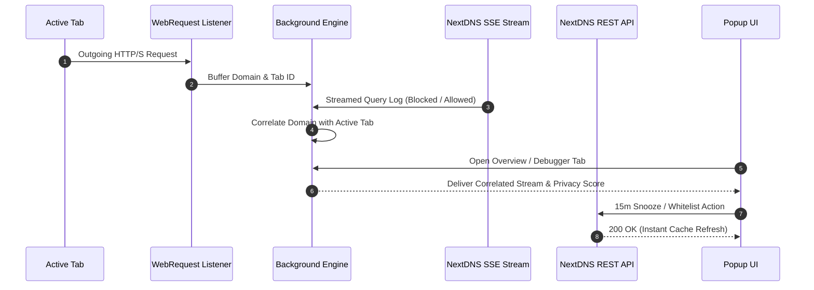
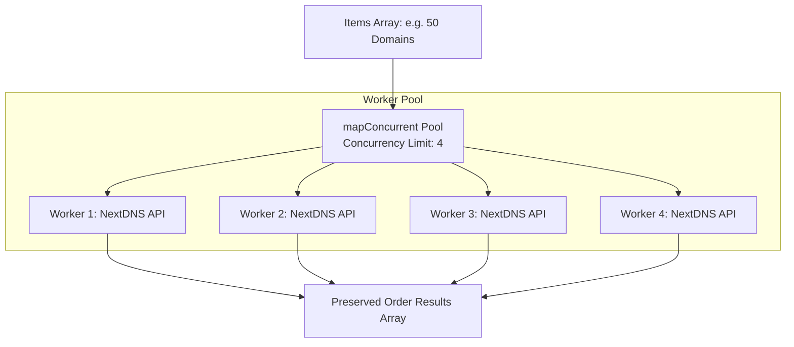

> [!note] Project Documentation Wiki
> *Part of the **[[dns-forge/index|DNS Forge Technical Wiki]]**.*

# 🏗️ System Architecture & Data Flow

DNS Forge is built upon a decoupled, asynchronous WebExtension architecture designed to handle high-frequency DNS query streams and multi-profile operations with zero UI freezing and minimal memory consumption.

---

## 1. Modular Domain Structure

```
src/
├── background/           # Event Page & Core Services
│   ├── main.js           # Lifecycle bootstrap, icon actions, storage migration
│   ├── api.js            # NextDNS API client, profile detection, DDNS, diagnostics
│   ├── handlers.js       # Message router (TOGGLE_SETTING, DEBUG_TAB, etc.)
│   ├── state.js          # In-memory runtime state, network status, log buffers
│   ├── scheduler.js      # Automation rule engine powered by browser.alarms
│   ├── logStream.js      # Server-Sent Events (SSE) query stream manager
│   ├── requestListener.js# WebRequest request auditor & tab-level buffering
│   └── utils.js          # Pure domain utilities, IP validators, formatters
├── ui/                   # Popup Presentation Layer
│   ├── main.js           # DOM bootstrap, tab routing, delegated event listeners
│   ├── dashboard.js      # Overview request tracker, SSE row rendering, privacy score
│   ├── blocks.js         # Protection toggles, blocklists, TLDs, parental lists
│   ├── tools.js          # Tab debugger, 15m snooze, PoP network diagnostics UI
│   ├── theme.js          # 6-color custom palette engine, live CSS variable injection
│   ├── presets.js        # Security & privacy one-click templates
│   ├── scheduler.js      # Time-based rule editor
│   ├── state.js          # UI state, active profile, selected lists
│   ├── notifications.js  # Action Center alert manager & badge counters
│   └── utils.js          # Sanitization (setSafeHTML), toast helpers, modals
├── content/              # Web Console Enhancements
│   ├── injections.js     # DOM manipulation utilities for my.nextdns.io
│   └── content.js        # MutationObserver, accordion rollups, device aliases
├── apiClient.js          # Resilient HTTP client, mapConcurrent bounded pool
├── storage.js            # Centralized StorageManager, memory cache, auto-healing
├── metadataManager.js    # Three-tier metadata fallback loader
└── viewer.js             # Standalone full-screen Data Manager (viewer.html)
```

---

## 2. Telemetry & Query Data Flow



---

## 3. Bounded Concurrency Task Worker (`mapConcurrent`)

To prevent browser lockups and HTTP 429 rate limits when executing bulk operations, all asynchronous tasks are routed through a bounded concurrency worker pool:



### Key Concurrency Invariants
- **Strict Bounds:** Concurrency is clamped to `4` (maximum 16).
- **Result Order Preservation:** Results are indexed directly into an array pre-allocated to the length of the input.
- **Fault-Tolerant Worker Isolation:** Individual item errors are caught and recorded as `{ error: message }` without terminating sibling tasks.

---

## 4. 🔐 Security & Privacy Posture

1. **Zero External Telemetry**: The extension transmits data exclusively to official NextDNS infrastructure (`https://*.nextdns.io/*`). No Google Analytics, Sentry, or third-party trackers exist.
2. **Strict DOM Sanitization (`setSafeHTML`)**: All dynamic HTML injections pass through `DOMParser` tree sanitization to eliminate Cross-Site Scripting (XSS) risks.
3. **Encrypted Client Storage**: API keys and profile settings reside in `browser.storage.sync` and `browser.storage.local`, protected by Firefox's profile container sandboxing.
4. **Memory Leak Protection**: In-memory debounce timers and query log buffers are capped with strict FIFO eviction (maximum 100 queries, 20 snapshots, 60s debounce TTL).
